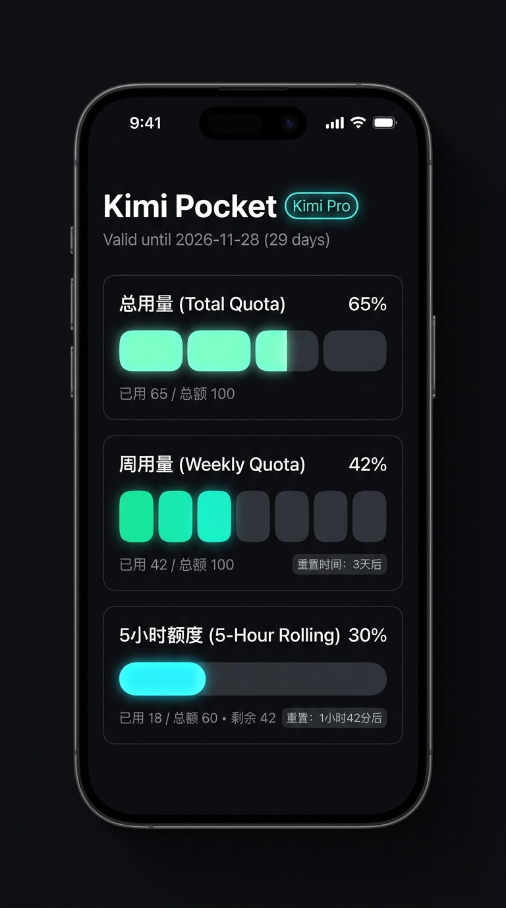
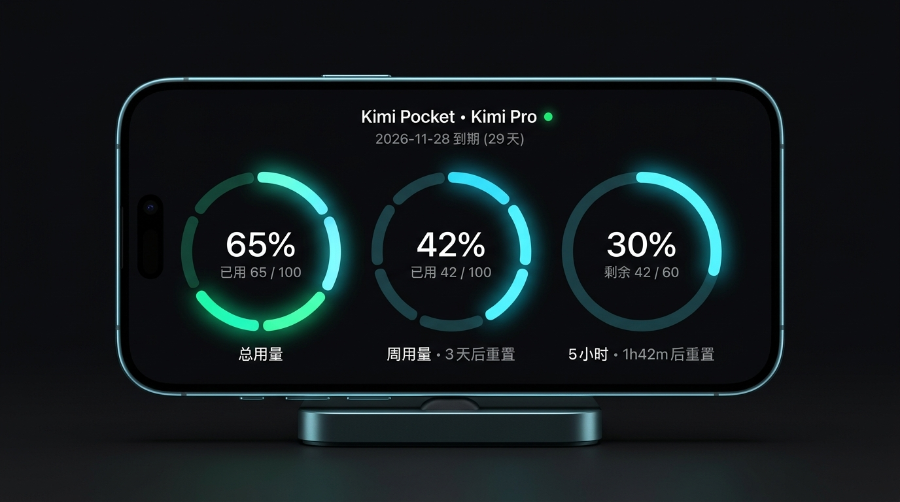

<div align="center">
  <h1>Kimi Pocket</h1>
  <p><strong>把 Kimi Code 用量，装进口袋。</strong></p>
  <p>专为移动端打造的订阅额度监控工具，支持 Android 与 PWA。</p>

  <p>
    <a href="https://github.com/yangguan-xue/Kimi-Pocket/releases/latest"></a>
    <a href="https://github.com/yangguan-xue/Kimi-Pocket/actions"></a>
    <a href="LICENSE"></a>
  </p>

  

  <p>
    <a href="#快速开始">快速开始</a> ·
    <a href="#界面预览">界面预览</a> ·
    <a href="#凭证配置">凭证配置</a> ·
    <a href="#本地开发">本地开发</a>
  </p>
</div>

## 少一点查询，多一点掌控

无需打开浏览器控制台，也不必反复翻查订阅页面。Kimi Pocket 将总额度、周额度、5 小时窗口和重置时间浓缩到一个纯黑界面中，让剩余量与恢复时间一眼可见。

- **双形态布局**：竖屏使用分段卡片，横屏切换为三环仪表盘，而不是简单拉伸页面。
- **状态一眼可辨**：正常、紧张、告急分别使用翡翠绿、琥珀黄与红色提示。
- **自适应刷新**：根据最低剩余额度调整轮询间隔，回到前台时立即更新。
- **静默续期**：可选填入 `refresh_token`，在访问凭证临期或鉴权失效时尝试自动换新。
- **移动端细节**：支持沉浸式全屏、剪贴板一键粘贴，以及软键盘弹起时仍可操作的凭证弹窗。

## 界面预览

<table>
  <tr>
    <td width="38%" align="center" valign="middle">
      <strong>竖屏 · 分段卡片</strong><br/><br/>
      
    </td>
    <td width="62%" align="center" valign="middle">
      <strong>横屏 · 三环 HUD</strong><br/><br/>
      
    </td>
  </tr>
</table>

## 快速开始

<a href="https://github.com/yangguan-xue/Kimi-Pocket/releases/latest/download/Kimi-Pocket-latest.apk"><strong>下载最新 Android APK</strong></a>

1. 下载并安装 APK；如系统提示，请允许安装来自当前来源的应用。
2. 打开 Kimi Pocket，点击右上角的 Token 设置。
3. 填入 `access_token`，可选填入 `refresh_token`，保存后即可查看用量。

也可以前往 <a href="https://github.com/yangguan-xue/Kimi-Pocket/releases/latest">Releases</a> 查看历史版本与构建产物。

## 凭证配置

在电脑浏览器中登录 <a href="https://kimi.moonshot.cn/">Kimi 官网</a>，打开开发者工具的 **Application → Local Storage → `https://kimi.moonshot.cn`**，复制以下字段：

| 字段 | 是否必填 | 用途 |
| --- | --- | --- |
| `access_token` | 是 | 当前接口鉴权 |
| `refresh_token` | 否，推荐 | 自动续期访问凭证 |

将凭证粘贴到应用的 Token 设置中并保存。`refresh_token` 失效、被撤销或续期接口拒绝请求时，仍需重新配置。

> 凭证属于敏感信息，请勿分享给他人。凭证保存在设备本地 LocalStorage，仅用于请求 Kimi 官方接口；本项目没有自建中转服务器，也不会主动收集使用日志。

## 刷新策略

应用按三类额度中的最低剩余比例自动调整频率：

| 当前状态 | 刷新间隔 |
| --- | --- |
| 正常 | 60 秒 |
| 任一额度剩余不超过 30% | 30 秒 |
| 任一额度剩余不超过 10% | 15 秒 |

切回应用前台会立即刷新，也可以点击右上角刷新按钮手动更新。

## 本地开发

环境要求：Node.js 20、npm；构建 Android 时另需 JDK 21 与 Android SDK 35。

```bash
git clone https://github.com/yangguan-xue/Kimi-Pocket.git
cd Kimi-Pocket
npm ci
npm run dev
```

常用命令：

```bash
npm test              # 运行单元测试
npm run build         # 类型检查并构建 Web / PWA
npm run build:android # 构建前端并同步 Capacitor 原生工程
```

构建 Debug APK：

```bash
cd android
./gradlew assembleDebug
```

产物位于 `android/app/build/outputs/apk/debug/app-debug.apk`。

## 技术栈

React 19 · TypeScript · Vite 6 · Tailwind CSS · Capacitor 7 · vite-plugin-pwa · Vitest

## 致谢

- [nekocharm1207/kimi-island](https://github.com/nekocharm1207/kimi-island)：协议解析与设计思路的重要参考。
- [Capacitor](https://capacitorjs.com/)：跨平台原生应用运行时。
- [Tailwind CSS](https://tailwindcss.com/) 与 [Lucide](https://lucide.dev/)：界面样式与图标。

## 许可证

基于 [MIT License](LICENSE) 开源。
