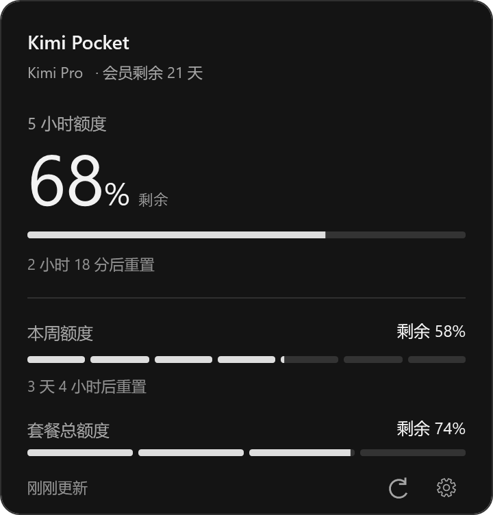

# Windows v0.1.0 · 首个托盘预览版

Kimi Pocket 首个 Windows 原生托盘版本，适用于 **Windows 11 x64**。本版本为预览版，使用独立标签 `windows-v0.1.0`，不替换现有 Android/macOS 正式版本。



截图使用演示数据。

## 本版功能

- 按确认的示意图实现黑灰白实色面板，无毛玻璃与蓝色装饰。
- 托盘悬浮展开、移出收起，左键切换，右键提供刷新、设置与退出。
- 显示 5 小时、本周与套餐总剩余额度及重置时间，分别使用连续条、7 段条与 4 段条。
- Token 在线验证后保存至 Windows 凭据管理器；支持自动刷新、手动刷新及可选开机启动（默认关闭）。
- 区分离线、凭据过期、权限不足、限流与缺失数据，未知额度显示 `—`。
- 低额度保留灰阶，通过文字和托盘图标形态提示；本版不会变黄或变红。

## 下载与运行

1. 下载附件 **`Kimi-Pocket-windows-x64-0.1.0.zip`** 并完整解压。
2. 运行 **`Kimi-Pocket/KimiPocket.exe`**，保留同目录的 DLL 和 Assets。
3. 首次启动，在设置中填入 Kimi 的完整 `access_token`，点击“保存并验证”。
4. 在右下角通知区域找到图标；若位于折叠区，可将其拖到常驻区域。

便携包自带 .NET 运行时，无需单独安装 .NET 或以管理员身份运行。本版未进行代码签名，Windows 可能显示发布者未知提示。下载后的完整性可通过附件 `.sha256` 校验：

```powershell
Get-FileHash .\Kimi-Pocket-windows-x64-0.1.0.zip -Algorithm SHA256
```

ZIP 大小：63,232,595 字节（约 60.30 MiB）。SHA256：

```text
2BE2769D947BCCE2E742C8129CF5E1CDA15E47E36BB1BAF869DA8749C861DB8A
```

## 验证与已知限制

- Release 编译零警告、零错误；75 项自动化测试通过（55 Core + 20 Windows）。
- 实际 ZIP 已解压启动，确认运行时从包内加载；已完成面板多状态截图与 100 次原生显示/隐藏资源检查。
- 真实账号端到端、多屏混合 DPI、托盘折叠区与键盘全流程、Narrator/高对比度、Explorer 重启/睡眠恢复，以及无预装运行时的干净系统，仍待完整实机验收。
- 截图倍率验证属于离屏渲染，不代表混合 DPI 系统验收完成。

详细验收记录见 [Phase 6](https://github.com/yangguan-xue/Kimi-Pocket/blob/windows-v0.1.0/tasks/phase-6-windows-tray/evidence/acceptance.md)。

## 退出与移除

在托盘右键菜单中退出。如需移除，先在设置中关闭开机启动并删除凭据，再退出应用并删除解压目录；直接删除目录不会清除 Windows 凭据管理器或已启用的启动项。
