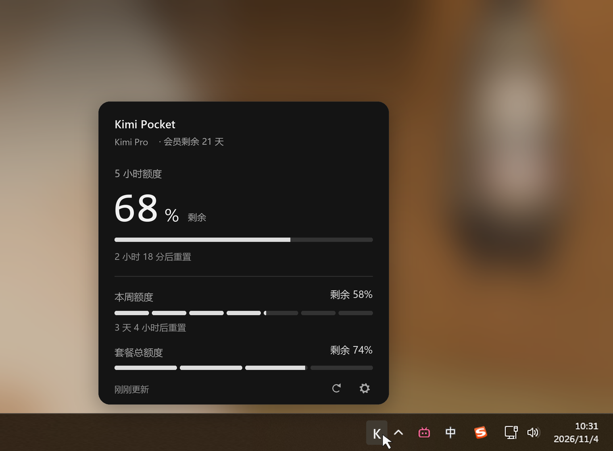
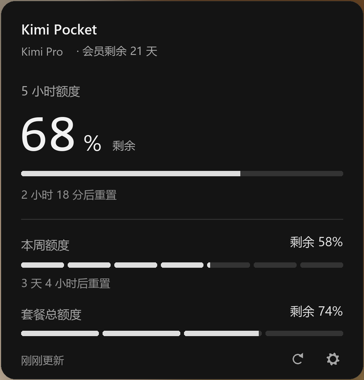

# Windows 托盘应用：已确认视觉基准

- **状态**：`APPROVED`
- **确认日期**：2026-11-04
- **确认依据**：用户对本轮示意图回复“完美的，拆 tasks 吧，以这个示意图为标准开发”。
- **关联规范**：[SPEC-07](../../SPEC-07-windows-tray-app.md)

## 基准图

[桌面与托盘场景](./windows-tray-concept.png)用于确认展开位置、整体比例与任务栏的关系。

[面板特写](./windows-tray-panel.png)用于确认面板内部结构、配色、排版和段条。两张图是同一方案的场景图与裁切图，不是两个候选。

## 必须保持的设计

| 维度 | 实施基线 |
| --- | --- |
| 面板 | 单个不透明深色表面，360 × 376 DIP 为正常状态目标尺寸；14 DIP 圆角，横向内边距 20 DIP |
| 背景 | `#141414`；无毛玻璃、Acrylic、Mica、蓝色、渐变和光晕 |
| 顶部 | Kimi Pocket 标题，下一行套餐名称与会员剩余天数；无彩色徽章 |
| 主额度 | 5 小时额度，大数字 + 小百分号 + “剩余”，字形底部对齐；数字约 52 DIP |
| 主进度 | 320 DIP 宽、5 DIP 高的连续条；填充与底轨均为中性色 |
| 次额度 | 本周额度 7 段、套餐总额度 4 段；标签左对齐，剩余百分比右对齐 |
| 数值语义 | 三项全部为“剩余”；段内允许部分填充 |
| 分区 | 依靠留白和一条细分隔线组织，无嵌套卡片 |
| 底部 | 左侧更新时间，右侧刷新和设置图标；操作区域不小于 28 × 28 DIP |
| 交互 | 托盘悬浮显示，面板位于图标上方；定位允许因工作区边界向内调整 |

## 对照方法与允许差异

- 场景图为 1520 × 1120 px；面板特写为 724 × 756 px，包含四周约 1 DIP 的裁切余量，按 2× 展示；不能把图片物理像素直接作为 DIP。
- 固定设计态使用：套餐 `Kimi Pro`、会员剩余 21 天、5 小时剩余 68%、重置 2 小时 18 分；周剩余 58%、重置 3 天 4 小时；总剩余 74%。这是脱敏演示数据，生产不得默认使用。
- 实施中提供明确的设计预览入口；使用上述固定数据截图，对齐面板边界后并排/叠加比较。真实账号数据不用于复现这张参考图。
- 100% 缩放下，对主要边界、内边距、条高、段间距的误差目标不超过 2 DIP；字体抗锯齿不要求逐像素一致。不得用容差解释明显的布局、层级或颜色变化。
- 字体按系统可用性回退；正文保持可读，底部辅助文字采用至少 11 DIP。允许对参考图中的亚像素字号做可读性修正，但不能改变信息层级。
- 高对比度、文字放大、内容缺失、错误提示可按 SPEC-07 调整颜色或高度；这些状态不能用固定正常态截图强行挤压。
- 场景背景是根据用户截图重构的桌面环境；任务栏其他软件、壁纸、鼠标指针以及临时 K 图标不是应用窗口内容，也不作为产品必须复制的资产。托盘最终图标按 SPEC-07 验收。
- 图形数据、窗口行为和无障碍规则以 SPEC-07 为准；正常态视觉冲突优先保持用户已确认的图，再同步修正规范，不自行换设计。

## 基准文件校验

基准图片保持原文件，不在同一路径静默覆盖；改版需另存新版本并记录用户确认。

| 文件 | SHA-256 |
| --- | --- |
| `windows-tray-concept.png` | `0da044d0b6ac4eb19492e43acee687125813057672aabd0ec7cd7047c0c49432` |
| `windows-tray-panel.png` | `2db2eb955ea6a797f0985391bf361c1e1634cd13dcae3ad99e65130fd46e2cc9` |
