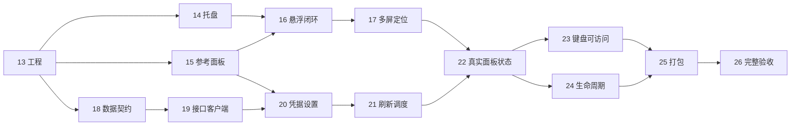

# Phase 6：Windows 托盘应用实施任务

- **计划状态**：`IMPLEMENTED / ACCEPTANCE IN PROGRESS`（首版已打包，完整实机验收进行中）
- **日期**：2026-11-04
- **规范**：[已确认 SPEC-07](../../specs/SPEC-07-windows-tray-app.md)
- **设计依据**：[视觉基准](../../specs/assets/windows-tray/README.md)

以用户确认的示意图为正常态视觉标准，完成 Windows 11 x64 原生 WPF 托盘应用。首期为单账号、统一剩余语义、无毛玻璃和蓝色，采用 Credential Manager 与免安装 ZIP。

Task 13–25 已有实现与可运行的构建入口；Release 零警告、零错误，75 项测试通过，0.1.0 自包含 ZIP 已完成本机解压启动。完整系统交互仍待实机验收，Task 26 保持 IN_PROGRESS。[证据索引](evidence/README.md) 区分已通过结果和待测条件。

## 任务清单

| 任务 | 可交付结果 | 前置任务 | 验收映射 | 状态 |
| --- | --- | --- | --- | --- |
| [Task 13](./task-13-project-bootstrap.md) | Windows 工程与可验证构建入口 | 已确认 Spec | W01 的工程前置 | VERIFIED |
| [Task 14](./task-14-native-tray-host.md) | 原生托盘图标与退出闭环 | 13 | W01、W09 的图标部分 | IMPLEMENTED |
| [Task 15](./task-15-reference-panel.md) | 按已确认示意图还原额度面板 | 13 | W04、W05 | IMPLEMENTED |
| [Task 16](./task-16-hover-state-machine.md) | 悬浮展开与离开收起闭环 | 14, 15 | W02、W03 | IMPLEMENTED |
| [Task 17](./task-17-dpi-popup-placement.md) | 多屏定位与任务栏溢出区适配 | 16 | W07、W08 | IMPLEMENTED |
| [Task 18](./task-18-usage-data-contracts.md) | 真实额度模型与响应归一化 | 13 | W04、W06 的数据前置 | IMPLEMENTED |
| [Task 19](./task-19-http-usage-client.md) | 直连接口与独立分区错误处理 | 18 | W06 的网络前置 | IMPLEMENTED |
| [Task 20](./task-20-token-preferences.md) | 凭据配置与首次真实额度验证 | 15, 19 | W06、W13 的凭据部分 | IMPLEMENTED |
| [Task 21](./task-21-refresh-scheduler.md) | 去重刷新与恢复调度 | 19, 20 | W06、W11 的调度部分 | IMPLEMENTED |
| [Task 22](./task-22-live-panel-states.md) | 真实数据面板与异常状态闭环 | 15, 16, 17, 20, 21 | W04–W06 | IMPLEMENTED |
| [Task 23](./task-23-keyboard-accessibility.md) | 键盘入口与可访问操作 | 22 | W03、W09、W10 | IMPLEMENTED |
| [Task 24](./task-24-app-lifecycle.md) | 单实例与系统生命周期恢复 | 14, 20, 21, 22 | W11、W13 | IMPLEMENTED |
| [Task 25](./task-25-windows-packaging.md) | 自包含 ZIP 构建与使用说明 | 23, 24 | W12 | IMPLEMENTED |
| [Task 26](./task-26-release-acceptance.md) | 视觉回归与首版完整验收 | 25 | W01–W14 汇总 | IN_PROGRESS |

## 依赖与推荐顺序

图为主要依赖，任务元信息列出完整前置。默认顺序执行 13→14→15→16→17→18→19→20→21→22→23→24→25→26，先验证 Windows 原生悬浮风险，再接真实数据。

13 完成后，15 与 18 的工作内容相对独立；23 与 24 存在 App/窗口文件交集，需要顺序落地或协调改动。此说明仅用于安排依赖，不代表本轮启动并行代理。

## 检查点

| 时点 | 必须达到 | 未通过时处理 |
| --- | --- | --- |
| 14 后：原生入口 | 实机托盘可显示/退出，回调编码正确，无控制台 | 解决 Win32 消息与生命周期问题，不绕回 Web 壳 |
| 17 后：设计与悬浮 | 固定演示值还原基准，悬浮不抢焦点，多屏与溢出区可操作 | 回到 15–17 修正；修改主视觉须先同步用户 |
| 20 后：首次真实联调 | Token 安全存储，真实接口契约与额度模型可验证 | 修复解析/认证/存储，不以默认余额继续 |
| 22 后：日常使用闭环 | 自动与手动刷新、旧数据与错误状态均接入 | 补齐竞态与状态映射，保留失败证据 |
| 24 后：系统集成 | 键盘、高对比度、单实例、恢复与启动项通过 | 阻断发布，返回所属任务 |
| 26 后：首版可交付 | 可解压运行的 ZIP、W01–W14、视觉与性能证据完整 | 未实测或超标项明确保留，不标全部完成 |

检查点由测试与实机证据验证；只有改变已确认设计或范围时才额外请求产品决策，常规检查不新增审批环节。

## 视觉验收方法

1. 以仓库中已确认 PNG 为只读基准，实施固定数据的 `--design-preview` 入口。
2. 先验收 360 × 376 DIP 正常态及 4/7 段数学，再核对真实数据；禁止用演示值填补真实接口缺失。
3. 保存系统 100% 与 150% 截图，对齐边界后比较（本轮已有离屏 1×/1.5× 渲染，系统 DPI 实测待补）；主要几何误差目标 ≤2 DIP，字号回退与辅助功能差异注明原因。
4. 场景图只约束托盘关系，不复制用户桌面壁纸、其他托盘软件或鼠标指针到产品窗口。

## 风险与应对

| 风险 | 尽早验证 | 应对 |
| --- | --- | --- |
| 托盘溢出区因焦点变化关闭 | 16–17 | 不激活浮窗，分清图标与面板命中区域；不靠全局 Hook 或强制前台修补 |
| WPF 与物理坐标混用 | 17 | 独立几何函数 + 混合 DPI 实机验证 |
| 接口漂移或额度字段缺失 | 18–20 | 独立分区与精确窗口匹配，缺失明确不可用 |
| 凭据替换后旧请求覆盖 | 20–22 | 取消 + 代次检查，使用可控竞态测试 |
| 实现偏离已确认图 | 15、22、26 | 固定演示入口与不覆盖原图的截图对照 |
| 缺少干净系统/多屏设备 | 17、25–26 | 记录待测条件；模拟结果不替代必要实机结论 |
| 自包含包体与常驻资源混淆 | 25–26 | 分别报告 ZIP 大小、Private Bytes 与 Working Set |

## 执行约定

- 每项先完成其依赖；核心逻辑与行为改变配套测试，UI 通过真实 WPF 窗口验证。
- 各测试筛选执行非零用例，测试结果、运行环境和人工检查分别记录，不以新增测试文件代替测试通过。
- evidence 目录在执行任务时建立；优先记录短小 Markdown、脱敏截图与产物校验。运行日志、ZIP 与 bin/obj 不提交。
- 任务状态区分 TODO / IN_PROGRESS / IMPLEMENTED / VERIFIED；只有验证证据齐全才使用 VERIFIED，并另外记录用户验收情况。
- 本轮已实现 Windows 工程、完成本机构建和初步验证；以 `windows-v0.1.0` 标签交付 Windows 预览版，发布说明见 [版本说明](../../releases/windows-v0.1.0.md)。未测系统交互保持待验收，不将 Task 26 标为完成。
